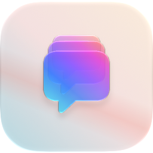
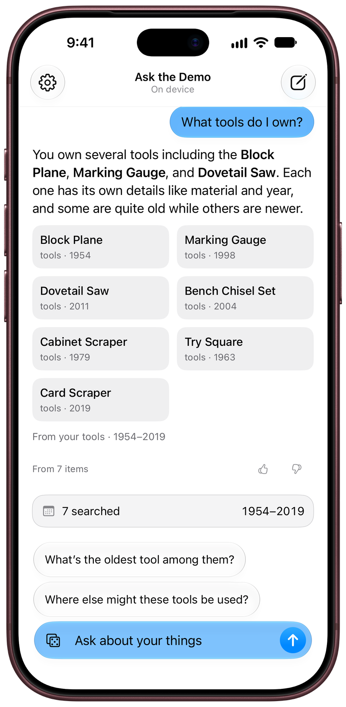
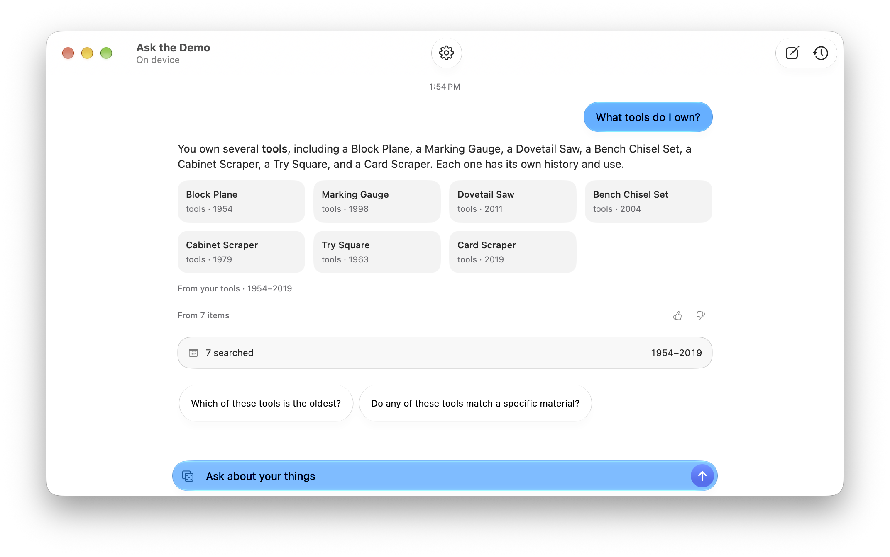
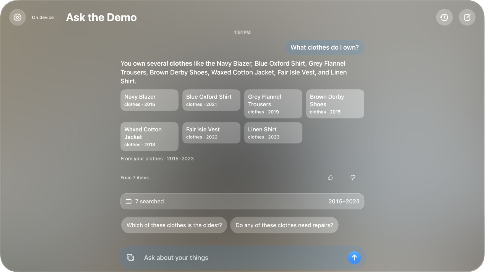
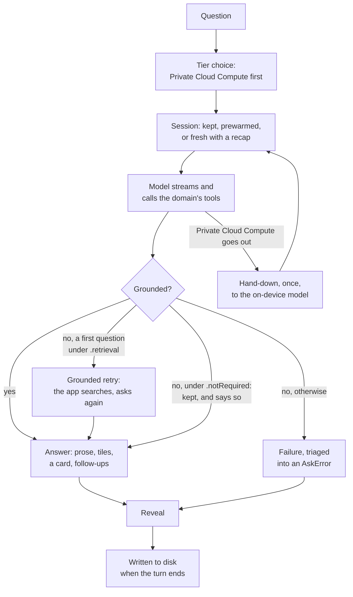

<p align="center">
  <picture>
    <source media="(prefers-color-scheme: dark)" srcset="docs/images/icon-dark.png">
    
  </picture>
</p>

# AskKit

[](https://github.com/gregyuzik/AskKit/actions/workflows/ci.yml)
[](Package.swift)
[](Package.swift)
[](LICENSE)

<p align="center">
  
  
  
</p>

AskKit is a complete Ask screen over Apple's Foundation Models, for any kind of app. A reader asks in their own words and gets a short answer: from your app's data, through the tools your app gives the model, or from the model alone where your app allows it. When a tool proposes an action, such as adding a reminder or changing a setting, the reader confirms it on a card before your app carries it out. Private Cloud Compute writes the answer when it can serve, and the on-device model when it can't. Your app implements one protocol, `AskDomain`, which gives the model its tools and instructions and says which answers are kept, and AskKit supplies the engine (`AskCore`) and the SwiftUI screen (`AskUI`).

A development build stays off Private Cloud Compute until you opt in, so it answers on the device. [Development builds and Private Cloud Compute](#development-builds-and-private-cloud-compute) says how to opt in.

To try the screen first, run the `AskKitDemo_iOS` scheme in `Demo/AskKitDemo.xcodeproj`: a library of thirty things to ask about, or, with the launch argument `-askAssistant`, which you add to the scheme yourself, an assistant with no data of its own that converts units and proposes reminders. With `-askScriptedAnswer`, either answers without a model ([The demo](#the-demo)).

## What you get

- **`AskCore`, the engine, with no UI.**
  - `AskEngine` runs one question at a time on the tier that can serve, Private Cloud Compute first, behind one model seam (`AskModelSeam`, which `AppleModelSeam` implements on Foundation Models). When Private Cloud Compute goes out mid-turn, the turn is handed down once to the on-device model (the hand-down).
  - Your domain's `grounding` policy decides which answers it keeps: by default only those grounded in your data, searching for the model and asking again when a first answer read nothing (the grounded retry); only those a tool call grounded; or every answer, each recording what grounded it. It carries the conversation from turn to turn and triages every failure into an `AskError` with a line for the reader in 25 languages. The engine writes nothing to disk: AskUI's store keeps the thread.
  - `AskEval` runs scenarios through a real engine. A host also uses `AskLink` (a deep link that prefills the composer and never sends), `AskProposal` (an action the model proposes and the reader confirms), `AskPrompt` (the clamps a tool puts fields through) and `AskEngine.answerOnce(_:)` (one answer outside the thread, for a Siri intent).
- **`AskUI`, the screen:** `AskScreen` and the `AskConversationStore` that drives it, which keeps the thread and the earlier chats on disk, through AskCore's `AskThreadStore` and `AskThreadArchive`. A host that takes AskCore alone keeps its own.
  - The first screen: ready, with your starters (questions the reader can tap); nothing to ask about yet, for a domain over rows the reader has none of; or can't serve, which says why.
  - The thread, where a turn shows its question; the wait row, saying what the tools are doing until the prose starts; the prose as it streams; your tiles, one view for each row the answer names, when it names rows; the evidence line, saying what the answer stood on ("From 7 items", your own words, or "Not from this app's data"); the card for an action the model proposed; and follow-up chips.
  - A composer that takes one accessory button of yours; New Chat, History and the tier caption, which names the model answering; and a banner when the day's Private Cloud Compute quota is spent.
  - `AskPrivateCloudCard` for your settings, and `AskCommands` for the Mac's menu bar.
- **What stays yours:** your tools, and whatever data they read; your instructions and your copy; which answers are kept; the views for your tiles and what opening one does; and the actions the model may propose, and what carrying one out does.

## Requirements

- **Xcode 27.2 or later**, on a Mac with Apple silicon, and Swift 6.4.
- **A deployment target of 27.2** on every platform you build for.
- **Platforms.** Both products build for iOS, macOS, visionOS, tvOS and watchOS, so a shared package can depend on them. The screen, and so Ask itself, exists on iOS, macOS and visionOS. On tvOS, AskCore's Foundation Models half (`AskDomain` and the engine with it) is compiled out, and on watchOS so is whatever names `SystemLanguageModel`, such as `AppleModelSeam`.
- **Apple Intelligence** on the reader's device, for the on-device model. When no model can serve, the first screen says why and the composer is off, unless your domain's `firstScreenPolicy` says it can answer without one.
- **For Private Cloud Compute, which is optional:** the managed entitlement `com.apple.developer.private-cloud-compute`, which Apple grants to eligible developers on request ([Accessing Private Cloud Compute](https://developer.apple.com/private-cloud-compute/), [the entitlement](https://developer.apple.com/documentation/BundleResources/Entitlements/com.apple.developer.private-cloud-compute)); your declaration of it to AskKit, `AskPrivateCloudCompute.declared`; a network connection; and some of the reader's daily quota. Without the entitlement, every question goes to the on-device model.

## Install

```swift
platforms: [.iOS("27.2"), .macOS("27.2"), .visionOS("27.2")],
dependencies: [.package(url: "https://github.com/gregyuzik/AskKit", from: "0.1.0")],
// and in the target that shows the screen:
dependencies: [.product(name: "AskCore", package: "AskKit"), .product(name: "AskUI", package: "AskKit")]
```

Those are lines of a `Package.swift` of yours: a shared package that also builds for tvOS or watchOS adds `.tvOS("27.2")` and `.watchOS("27.2")`, and an app's project sets its deployment target itself. Or, in Xcode, File > Add Package Dependencies with the same URL. Add the `AskUI` and `AskCore` products to the targets that show the screen; a target that needs only the engine, or a type such as `AskLink`, takes `AskCore` alone. `AskUI` doesn't re-export `AskCore`, so a file that uses both imports both. The module names are generic, so check that nothing else in your build is called `AskCore` or `AskUI`. AskKit has no dependencies of its own.

**Versions.** AskKit is at 0.x, and a minor version may break the API. A new case in a public enum is a breaking change, allowed in a 0.x minor version, because it stops an exhaustive `switch` compiling: a new minor version can mean adding a case to a `switch` of yours over one of AskKit's enums. `from: "0.1.0"` takes any release below 1.0.0, and `.upToNextMinor(from: "0.1.0")` holds you to 0.1.x. [CHANGELOG.md](CHANGELOG.md) says what changed.

## Adopt with a coding assistant

To adopt AskKit with a coding assistant, such as Claude Code, Xcode's coding intelligence or Cursor, give it this prompt in your app's project. The assistant adds the package and works through [Adopt](#adopt) over your app's own data; review what it writes against those steps.

```text
Add AskKit (https://github.com/gregyuzik/AskKit) to this app, so a reader can ask about the app's
data in their own words.

1. Add the Swift package https://github.com/gregyuzik/AskKit from "0.1.0" to the app target, and
   link its AskCore and AskUI products. AskUI doesn't re-export AskCore, so a file that uses both
   imports both.
2. Before writing code, read README.md and docs/ARCHITECTURE.md in that repository, and use only the
   API they and AskKit's doc comments name. Then study this app's data model: its types, where they
   are stored and how the app queries them.
3. Follow the README's Adopt steps. Implement one AskDomain over the app's data: Row (an AskRow),
   SearchArguments (@Generable), brand (an AskBrand), overview(), makeTools(_:),
   instructions(tier:isConversation:answerLanguage:), search(_:context:) and
   starters(overview:window:). Each tool runs its work in context.withToolCall, records every row it
   shows with record(rows:), clamps every field with AskPrompt.clamp and returns its lines unfenced.
   Choose grounding: .retrieval, .toolCall or .notRequired. If the tools read none of the app's
   rows, follow the README's "A domain without rows" instead.
4. Make one seam with AppleModelSeam.make(privateCloudCompute: .undeclared), passing .declared only
   if the app's entitlements file grants com.apple.developer.private-cloud-compute, and one
   AskEngine(domain:seam:).
5. Own one AskConversationStore(domain:engine:) at app scope, outside any view.
6. Show AskScreen(store:) in a NavigationStack with .navigationTitle(store.brand.title), where the
   app wants Ask, such as a tab of its own.
7. Put the brand's copy, the starters and every other string the reader sees in the app's String
   Catalog, resolved with String(localized:).
8. Set the deployment target to 27.2 or later on every platform. In a target with main-actor default
   isolation, mark the types AskKit uses off the main actor nonisolated and each tool's call
   @concurrent. Ask shows on iOS, macOS and visionOS: in a target that also builds for tvOS or
   watchOS, gate Ask's code as the README's Requirements and step 1 describe.
9. Build and run. A development build answers on the device until you opt in to Private Cloud
   Compute: https://github.com/gregyuzik/AskKit#development-builds-and-private-cloud-compute
```

## Adopt

An app adopts AskKit in five steps. The code in steps 1 to 4 is [`Tests/AskCrossPostureTests/ReadmeDomain.swift`](Tests/AskCrossPostureTests/ReadmeDomain.swift), a domain over the app's own rows, which the package's tests compile and run; [a domain without rows](#a-domain-without-rows), after step 5, has a file of its own. [`Demo/AskKitDemo`](Demo/AskKitDemo) does both with more of the optional pieces.

### 1. Implement `AskDomain`

Three members have no default. The two associated types, which name your row and your search's arguments, and `overview()` and `search(_:context:)` have defaults that suit only a domain whose tools read no rows ([A domain without rows](#a-domain-without-rows)), so a domain over your data, as this one is, gives all seven:

| Member | What you give it |
|---|---|
| `Row` | Your row, an `AskRow`: `Codable`, `Sendable`, `Identifiable` and `Equatable`, with a `displayTitle` that the model reads in tool output and writes back when it picks tiles. Rows are written into the thread file, so give a field you add later a default when it decodes. |
| `SearchArguments` | A `@Generable` type, the arguments your tool takes, so that when the model won't call the tool, the app's own search chooses them the way the model would have. |
| `brand` | An `AskBrand`: your copy, the Application Support folder the thread is kept in, and the log subsystem every AskKit logger writes under. |
| `overview()` | What the reader has to ask about: scopes and counts. |
| `makeTools(_:)` | The tools a session offers the model, built around the `AskToolContext` it is handed. |
| `instructions(tier:isConversation:answerLanguage:)` | The session's instructions: yours, and short. |
| `search(_:context:)` | The search the app runs when the model won't call a tool, through the tool's own code. |

```swift
import AskCore
import Foundation
import FoundationModels

/// One book on the reader's shelf. Every type here is `nonisolated`, because
/// AskKit uses them off the main actor.
nonisolated struct Book: AskRow {
    let id: String
    let title: String
    let author: String

    var displayTitle: String { title }

    /// Stands in for the app's own store.
    static let shelf = [
        Book(id: "b1", title: "The Dispossessed", author: "Ursula K. Le Guin"),
        Book(id: "b2", title: "Housekeeping", author: "Marilynne Robinson"),
        Book(id: "b3", title: "A Pattern Language", author: "Christopher Alexander")
    ]
}

/// The search's arguments: the model fills them in, or the app for the grounded retry.
@Generable
nonisolated struct BookQuery: Sendable {
    @Guide(description: "Words from the question: a title or an author. Short and literal.")
    var words: String
}

/// The one lookup: the model's tool, and the grounded retry's search.
nonisolated struct SearchBooks: Tool {
    let name = "search_books"
    let description = "Search the reader's books by any words from the question. Call this before answering anything about what they own."

    let context: AskToolContext<Book>

    // `@concurrent`, or the lookup runs on its caller's actor.
    @concurrent func call(arguments: BookQuery) async throws -> String {
        // Notes the call, finishes it however the lookup ends, then reports what it read.
        await context.withToolCall(.searching(scope: nil)) { collector in
            let words = arguments.words.split(whereSeparator: { !$0.isLetter }).map(String.init)
            let found = Book.shelf.filter { book in
                // Ignores case and accents, so "garcia marquez" finds "García Márquez".
                let text = "\(book.title) \(book.author)"
                return words.contains { text.localizedStandardContains($0) }
            }
            let shown = Array(found.prefix(context.rowLimit))
            // An answer's tiles resolve only against recorded rows.
            await collector.record(rows: shown)
            return (Self.render(shown, of: found.count), report: .reading(shown: shown.count, total: found.count, scope: nil))
        }
    }

    // Every field clamped, so none can spell a tag to the model, and no fence of its own.
    private static func render(_ shown: [Book], of total: Int) -> String {
        guard !shown.isEmpty else { return "No matches." }
        var lines = shown.map { "\(AskPrompt.clamp($0.title, AskPrompt.shortClamp)) | \(AskPrompt.clamp($0.author, AskPrompt.shortClamp))" }
        if total > shown.count { lines.append("(+\(total - shown.count) more not shown)") }
        return lines.joined(separator: "\n")
    }
}

/// Everything about Ask that is this app's rather than AskKit's.
nonisolated struct LibraryDomain: AskDomain {
    typealias Row = Book
    typealias SearchArguments = BookQuery

    let brand = AskBrand(
        title: "Ask My Library",
        shortLabel: "Ask",
        appDirectory: "MyLibrary",
        logSubsystem: "com.example.mylibrary",
        help: "Ask about your books",
        firstScreenHeadline: "Ask about your books",
        firstScreenSentence: "Find, count and compare what is on your shelves.",
        nothingToAskCopy: "Add a book to start asking.",
        disclosureSentence: "Questions are answered on this device.",
        scopeCaveat: "Ask reads only your library. It can't search the web, and it can be wrong."
    )

    func overview() async -> AskOverview {
        let count = Book.shelf.count
        return AskOverview(scopes: [AskOverview.Scope(id: "books", name: "books", count: count)], total: count)
    }

    func makeTools(_ context: AskToolContext<Book>) -> [any Tool] {
        [SearchBooks(context: context)]
    }

    func instructions(tier: AskTier, isConversation: Bool, answerLanguage: String?) -> String {
        var text = """
            You answer questions about the books one person owns, and about nothing else.
            Call search_books before you answer, and name only titles it returned.
            """
        if let answerLanguage { text += "\nWrite the answer in \(answerLanguage)." }
        return text
    }

    func search(_ arguments: BookQuery, context: AskToolContext<Book>) async throws -> String {
        try await SearchBooks(context: context).call(arguments: arguments)
    }

    // Optional. Without it the first screen has its copy and the composer, and no chips.
    func starters(overview: AskOverview, window: Int) -> [AskStarter] {
        [AskStarter(text: "How many books do I own?"), AskStarter(text: "Which of my books is by Ursula K. Le Guin?")]
    }
}
```

The file wraps this in `#if canImport(FoundationModels) && !os(tvOS)`, because `AskDomain` and the engine are compiled out on tvOS. A target that builds for tvOS needs the same gate.

Three things in that code are rules, not style:

- **A tool is built once per session, and reports every call.** It keeps `context` and nothing per turn. It runs each call's work in `context.withToolCall(_:_:)`, which notes the call with the collector, finishes it however the work ends, and only then hands the phrase the work returns to the relay, because the finish clears a phrase reported before it. Inside, it records every row it shows the model with `record(rows:)`, since an answer's tiles resolve only against recorded rows.
- **A tool's output is the reader's data, and AskKit fences it.** Put every field through `AskPrompt.clamp`, show at most `context.rowLimit` rows, and return the lines bare: no fence of your own, and none of AskKit's tag names (`user_request`, `rows`, `previous_question`, `previous_answer` and `tool_result`). AskKit fences what it composes, and a wrapper of your own would be redacted in the grounded retry. `clamp` swaps angle brackets for lookalikes, flattens newlines, redacts AskKit's fence tags, cuts to the limit and holds each character to 16 Unicode scalars, then redacts again, cutting again if that lengthens it. So a field can't spell a fence tag in any spelling that compatibility decomposition (NFKD) maps to the tag once marks are dropped: in fullwidth, small or negated brackets (`＜`, `﹤`, `≮`), or in fullwidth, mathematical or accented letters. A letter of another script that only looks Latin spells another word. `AskPrompt.neuteringTags` does the bracket swap alone, for output whose line breaks carry its layout: pass such output through `AskPrompt.sanitizeForFence` first.
- **The search is written once.** `search(_:context:)` runs the tool's own code, so the grounded retry reads the rows the tool would have returned, and records them as the tool does.

**Isolation.** AskKit builds with main-actor default isolation and `NonisolatedNonsendingByDefault`. In a target that does too, mark the types AskKit uses off the main actor `nonisolated`, as the sample does (a `Codable` payload you record needs it, or its conformance is main-actor isolated), and mark a tool's `call` `@concurrent`, since an `async` function that isn't runs on its caller's actor. A target with neither setting needs neither keyword: AskKit's public API is `nonisolated` throughout.

**Keep `instructions` short**, a few sentences that name only tools the session holds, and put mappings (which word means which category) in `@Guide`s and tool descriptions, where the model reads them as it uses them.

Everything else on `AskDomain` has a default, and each member's doc comment says what it does. The ones you will reach for first:

| Member | Default | What it is for |
|---|---|---|
| `starters(overview:window:)` | none | The questions the first screen offers, and the coaching under a refused or ungrounded answer. `window` is how many fit: three on iOS, eight on macOS and visionOS. |
| `grounding` | `.retrieval` | Which answers are kept: those grounded in your data, with the grounded retry (`.retrieval`); those a tool call grounded (`.toolCall`); or every answer, recording what grounded it (`.notRequired`). |
| `evidence(for:)` | `.counted` | The line under an answer: AskKit's count of the rows it read, your own words (`.line`), or none. |
| `replyShape` | `.full` | What the model writes: the answer, its question kind, the tiles it chose and the follow-ups (`.full`), or the answer and the follow-ups alone (`.prose`), for a domain whose answers never show tiles. On device the prose schema costs 192 tokens of the window where the full one costs 704. |
| `promptLines(question:overview:)` | none | Lines such as today's date, sent when a question starts a fresh session. |
| `promptPrefix` | empty | Fixed words that open every prompt. Keep them byte-stable: a warm session caches them. |
| `phrase(for:)`, `basis(for:)`, `evidenceScope(from:)` | none | The wait row's words for a tool event, a factual line under an answer's tiles, and the part of your data the evidence line names. |
| `perform(_:)` | throws | Carries out a proposal the reader confirmed. |
| `deterministicAnswer(for:)`, `implementsDeterministicAnswer` | none, false | An answer with no model: small talk, or a starter on a device where nothing can serve. |
| `turnDeadline` | 45 seconds | How long one turn may run, counted from the question. |
| `rowLimit(for:)`, `maxTurns(for:)` | 40 and 8 on Private Cloud Compute, 12 and 3 on the device | The rows a tool result may show, and the turns a session carries before it rolls over. |

### 2. Make the seam and the engine

`AppleModelSeam` owns what the process knows about its models: which tier can serve, the cooldown after a failure, the quota and the generation gate. Build one for the process, and one `AskEngine(domain:seam:)` for the thread. `privateCloudCompute:` has no default: pass `.declared` only if your entitlements file holds the Private Cloud Compute entitlement, and `.undeclared` otherwise. A host that already routes its own model calls can bridge its router to `AskModelSeam` instead, wrapping each session in `AppleAskSession`, so Ask and its other features share one cooldown and one generation gate.

```swift
import AskCore
import AskUI
import SwiftUI

/// The one Ask, owned by the app and not by a view, so the thread outlives every view.
@MainActor
final class LibraryAsk {
    let store: AskConversationStore<LibraryDomain>

    init() {
        let domain = LibraryDomain()
        // `.declared` only if the entitlements file holds Private Cloud Compute's.
        let seam = AppleModelSeam.make(privateCloudCompute: .undeclared)
        let engine = AskEngine(domain: domain, seam: seam)
        store = AskConversationStore(domain: domain, engine: engine)
    }
}
```

### 3. Own one store at app scope

`AskConversationStore` is the screen's state: the turns, the turn in flight and the draft. Make one for the life of the app and hold it outside any view, as `LibraryAsk` does, for example in your `App` as `@State private var ask = LibraryAsk()`. A Mac `NavigationSplitView` rebuilds its detail on every sidebar change, so a store owned by a view would lose the thread, and a turn in flight with it. Making the store reads nothing: the screen reads the saved thread as it appears.

### 4. Host `AskScreen` in a navigation stack

Show `AskScreen` in a `NavigationStack` titled with `store.brand.title`. The screen sets no title of its own, and puts New Chat, History (for a domain that keeps its thread) and the tier caption in the toolbar, so outside a navigation container they have nowhere to render.

```swift
/// The screen in a navigation stack, titled with the brand's title.
struct AskTab: View {
    let ask: LibraryAsk

    var body: some View {
        NavigationStack {
            AskScreen(store: ask.store)
                .navigationTitle(ask.store.brand.title)
        }
    }
}
```

`AskScreen(store:)` takes the store and the screen's options (`accent:`, `spectrum:`, `onNothingAction:`, `onAttach:` and `composerAccessory:`), and draws AskKit's own mark and tiles. Your views replace them with modifiers, in any order: `mark(_:)`, `tiles(_:)`, `evidenceDisclosure(_:)` and `answerFooter(_:)`. These are the only way to set your views: the initializer takes the store and the screen's options alone. A `tiles` builder is handed the rows; the turn and the rows; or the turn, the rows and an `open` closure, nil where nothing opens. Return an `AskTileGrid`, so the tiles arrive one at a time. A value a builder captures reaches answers already on screen only through `buildersDepend(on:)`. On iPhone Duo's inner display the screen arranges itself around the fold, with nothing for you to wire.

### 5. Wire the optional pieces

| Piece | How | Notes |
|---|---|---|
| Tiles that open a row | A class of yours conformed to `AskItemRouter` (`func open(_ id: Book.ID)`), and `.environment(\.askItemOpener, AskItemOpenAction(router))` above the screen | The id is typed by the router's `open(_:)`. A router for another id type opens nothing, and AskKit logs it once for each id type. With no opener, tiles are inert. Keep the router in `@State` or on an object the app holds: two actions on one router are equal, so building the action in a body redraws nothing, and a new router redraws every bank of tiles in the thread. |
| A page pushed over the screen | `.environment(\.askItemIsPushed, pushedID != nil)` on the screen | The screen holds its navigation bar open while it's true: a page pushed while the bar is minimized hangs the app. |
| Actions the model proposes | A tool records an `AskProposal`, and you implement `AskDomain.perform(_:)` | The answer shows a confirmation card, and only the reader's tap reaches `perform`, which should be safe to run twice. A proposal that opens your own editor is a hand-off: conform a class to `AskDraftRouter` (`func open(_ proposal: AskProposal)`), set `askDraftOpener` to `AskDraftOpenAction(router)`, keeping the router as the tile opener's is, and `perform` is never called. Leave a proposing tool out where `context.isConversation` is false. |
| A photo or a scan | `acceptsPhotoAttachments`, `AskScreen(store:onAttach:)` and `store.attachPhoto(_:label:reference:)`, or `AskScreen(store:composerAccessory:)` | A composer has one accessory button: yours (`AskComposerAccessory`) or the photo button. Only Private Cloud Compute reads photos; on the device the question runs on its words, and the thread says so. |
| A spectrum look | `AskScreen(store:spectrum:)` with `.aurora`, or `AskSpectrum([…])` of your own colors | The send circle and the reveal's caret take a gradient of the colors, on the slot's face too; everything else keeps `accent`. The send circle's glyph is white, or black where white falls under 3:1 on its lightest color. Increase Contrast puts the accent back. |
| The Ask tab's glyph | `Image(systemName: "text.bubble.badge.sparkles")` as the tab's `Label` icon | The glyph the demo's tab wears, in one colour like the bar's other items; AskKit ships none of its own. A host that wants two colours can give it `.symbolRenderingMode(.palette)`, whose first colour paints the sparkles and second the bubble. The bar then draws the colours as given and won't mark the selection, so pass the selected bubble's colour yourself, fixed and resolved for the colour scheme: in a tab item's palette `.tint` and `Color.accentColor` both come out the system blue whatever the app's accent, `.primary` comes out black on a dark bar, and a gradient is flattened to its first colour. The tab bar swaps in the `.fill` variant itself. |
| The tab bar slot (iOS) | `.askComposerSlot(store, isEnabled:)` on the `TabView` that holds Ask, with `.tabBarMinimizeBehavior(.onScrollDown)` | The composer's face rides in the tab view's bottom accessory, beside the tab bar when it minimizes. It does nothing on macOS and visionOS, so a shared host needs no `#if`. |
| The Mac menu | `.commands { AskCommands(store: ask.store) }` on the scene, or `AskCommands(isEnabled: ask.store.hasTurns) { … }` when your New Chat does more than start over | New Chat (⇧⌘N), Send (⌘Return) and Stop (⌘.) in the File menu, acting on the focused window's composer. `AskCommands` exists only on macOS, so a scene shared with iOS or visionOS wraps the modifier in `#if os(macOS)`, as the demo's `App.swift` does. |
| Entry points | `store.prefill(_:scope:send:)` and `store.focusComposer()` | `prefill` puts a question in the composer and the reader in front of it. `AskLink` builds and reads `<scheme>://ask?q=…` links, and a link only ever prefills. `scope` is your id for where the question came from, and `scopeLine(for:)` tells the prompt what it means. |
| The settings card | `AskPrivateCloudCard(store: ask.store)` in your settings | It says where answers come from, and why, with no toggle. `AskPrivateCloudCard(store:onRunEval:)` adds a row that runs your evaluation, shown where diagnostics are on: a Debug build, a TestFlight build on iOS or visionOS, or wherever you set `AskDiagnostics.enabledByApp`, which a Mac release build needs. |
| Siri and UI tests | `.appEntityIdentifier(…)` on each tile your `AskTileGrid` draws; `AskAccessibility` | An annotation per tile lets Siri resolve "this" to the item the reader means (`AskDefaultTiles` carries none). Every control has an `ask.*` identifier, so one UI-test recipe drives every host. |

### A domain without rows

Not every domain reads your app's rows. One whose tools work something out or act names neither associated type, so its `Row` is `AskNoRow` and its `SearchArguments` is `AskNoSearchArguments`, and it leaves `overview()` and `search(_:context:)` to their defaults. What it writes is its brand, its tools and its instructions, and its `grounding`, which decides what becomes of an answer no tool grounded: under `.notRequired` the answer is kept, and the line under it says it isn't from the app's data. With no rows to show, it asks for `.prose` replies, so the model spends none of the window on tiles. This code is [`Tests/AskCrossPostureTests/ReadmeAssistantDomain.swift`](Tests/AskCrossPostureTests/ReadmeAssistantDomain.swift), which the package's tests compile and run too, and steps 2 to 5 are the same for it.

```swift
import AskCore
import Foundation
import FoundationModels

/// The converter's arguments, which the model fills in.
@Generable
nonisolated struct Conversion: Sendable {
    @Guide(description: "The amount to convert.")
    var amount: Double
    @Guide(description: "The unit it is in: km, m, mi or ft.")
    var from: String
    @Guide(description: "The unit to convert it to: km, m, mi or ft.")
    var to: String
}

/// A tool that reads none of the app's data: it works the answer out and returns it as text.
nonisolated struct ConvertDistance: Tool {
    let name = "convert_distance"
    let description = "Convert a distance from one unit to another."

    let context: AskToolContext<AskNoRow>

    private static let units: [String: UnitLength] = [
        "km": .kilometers, "m": .meters, "mi": .miles, "ft": .feet
    ]

    @concurrent func call(arguments: Conversion) async throws -> String {
        // Noted as a call, so the turn counts as grounded by it. It records no rows.
        await context.withToolCall { _ in
            guard let from = Self.units[arguments.from.lowercased()],
                  let to = Self.units[arguments.to.lowercased()] else {
                // The model's own words, clamped like any field before they go back to it.
                let asked = "\(AskPrompt.clamp(arguments.from, AskPrompt.shortClamp)) to \(AskPrompt.clamp(arguments.to, AskPrompt.shortClamp))"
                return ("No conversion from \(asked).", report: nil)
            }
            let result = Measurement(value: arguments.amount, unit: from).converted(to: to).value
            return (String(format: "%g %@ = %g %@", arguments.amount, from.symbol, result, to.symbol), report: nil)
        }
    }
}

/// An assistant with no rows of its own: three members, the policy that keeps an answer no tool grounded, and a reply with no tiles.
nonisolated struct AssistantDomain: AskDomain {
    let brand = AskBrand(
        title: "Ask the Assistant",
        shortLabel: "Ask",
        appDirectory: "MyAssistant",
        logSubsystem: "com.example.myassistant",
        help: "Ask anything",
        firstScreenHeadline: "Ask anything",
        firstScreenSentence: "Convert a distance, or ask a question.",
        disclosureSentence: "Questions are answered on this device.",
        scopeCaveat: "Answers come from the model and its tools, and they can be wrong."
    )

    // Optional. The default, `.retrieval`, would fail every answer no tool grounded, "thanks" included.
    var grounding: AskGroundingPolicy { .notRequired }

    // Optional. The default, `.full`, also has the model name a question kind and choose tiles, which this domain never shows.
    var replyShape: AskReplyShape { .prose }

    func makeTools(_ context: AskToolContext<AskNoRow>) -> [any Tool] {
        [ConvertDistance(context: context)]
    }

    func instructions(tier: AskTier, isConversation: Bool, answerLanguage: String?) -> String {
        var text = """
            You are a helpful assistant inside an app. Answer in a few plain sentences.
            To convert a distance, call convert_distance and give its result.
            """
        if let answerLanguage { text += "\nWrite the answer in \(answerLanguage)." }
        return text
    }
}
```

A tool that proposes an action works here as it does over rows: it records an `AskProposal`, and the reader confirms it on the card (step 5). `evidence(for:)` words the line under an answer a tool grounded, which AskKit's count of rows leaves out when the tool read none. The demo's assistant (`-askAssistant`, [The demo](#the-demo)) does both.

## Development builds and Private Cloud Compute

**A development build never reaches Private Cloud Compute by default.** Two checks stand between a question and the tier:

- **The entitlement.** A Private Cloud Compute request from a process without it is a fatal trap, not an error. So the seam sends one only when you declared the entitlement and the running build doesn't prove it absent. The Mac and the simulator read their entitlements exactly; on a device, a provisioning profile without it proves it absent. TestFlight and App Store builds carry no profile, so your declaration is all there is: declare it only when your entitlements file grants it.
- **The development park.** The daily quota belongs to the iCloud account, and every development run would spend the developer's own, so `AskDevelopmentPark` keeps off the tier a test host or `swift test` run, a Debug build, a simulator, and a binary signed for development (`get-task-allow`: a Profile run, or a Release build installed by hand). A parked process sends Private Cloud Compute nothing, not even a prewarm, and its tier caption says "On device". **TestFlight and App Store builds are never parked.**

To measure the tier in a development run, opt in with `ASK_LIVE_PCC=1` in the environment (`yes` and `true` work too), the launch argument `-ASK_LIVE_PCC YES`, or a closure of your own passed to `AskDevelopmentPark.setAppOptIn(_:)`, from a build signed with the entitlement. The opt-in lifts the park and nothing else. A process outside an app's context, such as a command-line tool, fails every request at once with `LanguageModelError` −1 (`ModelManagerError 1001`), which AskKit reads as the tier being unreachable.

**The daily quota.** When the reader's quota is spent, the seam holds the tier until the reset, the turn that hit it is handed down to the on-device model, and a banner says when the quota comes back. Opening the screen warms no session, since a warm on Private Cloud Compute spends a request: AskKit warms one once the reader starts their own question, by typing it or editing one a link left in the composer. [docs/ARCHITECTURE.md](docs/ARCHITECTURE.md) has the order of the checks, under "Entitlements" and "The development park".

## What is stored, and where

With `persistence` at its default, `.thread`, AskKit keeps these under `Application Support/<appDirectory>/`, where `appDirectory` is your `AskBrand.appDirectory`. It must be one folder name: not empty, not `.` or `..`, and with no `/`. With any other, the stores read and write nothing, and AskKit logs a fault. The folder holds:

| Path | Holds |
|---|---|
| `ask-thread.json` | The chat on screen, its newest 50 turns: each question, the prose, the answer with the rows behind it (your `Row` values, encoded), the failure if there was one, the model that answered, when it was asked, and the reader's thumbs. A photo is kept as its label and your reference, never its pixels. |
| `threads/` | The earlier chats, at most 50, in the same format: `index.json` and one `<id>.json` for each. |
| `feedback/` | Feedback attachments, only where diagnostics are on and the reader rated an answer, at most 10. They leave the device only when the reader shares them from the settings card. |
| `ask-thread-unreadable-<id>.json`, `ask-thread-original-<id>.json` | A thread this build couldn't decode, or read only in part, set aside whole rather than overwritten, until a launch that reads it puts it back. |

A turn is written when it ends, never while it streams. Writes are atomic, off the main actor, excluded from backup, and under complete file protection on every platform but macOS, where that option fails the write. `persistence: .perLaunch` keeps the thread for the process only: nothing is restored or written.

**What a turn sends to Private Cloud Compute.** On the device, none of this leaves it. On Private Cloud Compute a turn sends your instructions, your tools' definitions and AskKit's reply schema; the prompt (when a session starts fresh, your `promptPrefix`, a recap of the thread's last exchanges and your `promptLines`; on a follow-up, the titles the last answer named; a scope line for a question asked from one part of your app; and the reader's question, clamped to 500 characters and fenced); what your tools return; the grounded retry's request and the rows it found, when the model won't search; and a photo, when the question has one. AskKit makes no network requests of its own, other than watching whether the device is online. [`AskBrand.disclosureSentence`](Sources/AskCore/AskBrand.swift) is where you tell the reader what leaves the device.

**The privacy manifest.** `AskCore`'s resource bundle carries a [`PrivacyInfo.xcprivacy`](Sources/AskCore/Resources/PrivacyInfo.xcprivacy), so your app's privacy report includes AskKit's part with nothing more from you. It declares the two required-reason APIs AskCore calls: user defaults for `CA92.1`, read only for the launch's own arguments (`ASK_LIVE_PCC`), and the file timestamp for `C617.1`, the modification date of a chat file in the folder above, inside your app's container. It declares no tracking, no tracking domains and no collected data: AskKit sends nothing to its developer or any third party. Answers come from Apple's Foundation Models on the device or on Private Cloud Compute, under Apple's terms, and the host app owns its data. `AskUI` calls none of these APIs and carries no manifest.

## The demo

`Demo/` is an app for iOS, macOS and visionOS over a small library of thirty things, books, records, tools and clothes, behind one search tool (`DemoDomain`). With `-askAssistant` it hosts a second domain in its place, `DemoAssistantDomain`: an assistant with no rows, which converts units with one tool, proposes reminders with another, and answers anything else from the model alone. It declares no Private Cloud Compute entitlement, so it always answers on the device. Its icon is three plates of Liquid Glass in the shape of the bubble in SF Symbols' `text.bubble.badge.sparkles`, the glyph its Ask tab and its mark wear, receding straight back and shading together through `AskSpectrum.aurora`'s colors; `scripts/make-demo-icon.py` makes it, tracing the bubble from the symbol. The symbol is Apple's, under Apple's SF Symbols terms.

Open `Demo/AskKitDemo.xcodeproj` and run the `AskKitDemo_iOS` scheme on an iPhone 18 Pro simulator, or `AskKitDemo_macOS` or `AskKitDemo_visionOS`. The simulator and the Mac need no signing. A real turn needs Apple Intelligence; `-askScriptedAnswer` needs no model. To run on a device, put `DEVELOPMENT_TEAM = <your team ID>` in an untracked `Demo/Local.xcconfig`. [docs/DEMO-PROJECT.md](docs/DEMO-PROJECT.md) says how the project is laid out and why its settings are what they are.

Every launch argument is declared in `Demo/Shared/DemoLaunchArgument.swift`, and all but `-askAssistant` and `-askHoldTurn` are listed, off, in each app scheme's Run > Arguments, so you tick one to use it. Those two aren't there: add one to the scheme's Run > Arguments in Xcode, or pass it at launch, as `xcrun simctl launch <device> com.example.askkitdemo -askAssistant`. The three that image the Mac window are in [docs/DEMO-PROJECT.md](docs/DEMO-PROJECT.md#imaging-the-mac-window), and the rest are here:

| Argument | What it shows |
|---|---|
| none | A real turn on the on-device model, with starters drawn from the thirty items, "Surprise me" before the composer, and a gear button for the settings card. |
| `-askResetThread` | An empty thread on every launch (`.perLaunch`): nothing is restored or saved. |
| `-askFreshHistory` | The thread kept, but everything AskKit keeps for the demo deleted before the store reads it: the saved thread, every earlier chat, any thread set aside because it couldn't be read, and the feedback attachments. A clean History sheet. |
| `-askScriptedAnswer` | Every question answered by the app, with no model. "What should I read tonight?" gets a pick with a basis line and Another pick, a question with "lend" in it gets a confirmation card, and anything else gets a two-tile lookup. The first screen keeps its starters even where Apple Intelligence is off. |
| `-askPrefill <link>` | An Ask link opened once at launch, such as `askkitdemo://ask?q=…`: the question lands in the composer with the keyboard up and isn't sent. A window reopened or a tab switched back to doesn't open it again. |
| `-askPhotos` | The photo button in place of "Surprise me". It attaches a record sleeve the demo draws, and the answer notes that it read only the words. |
| `-askTabs` (iOS) | The screen in a `TabView` of two tabs, Ask and Library. |
| `-askSlot` (iOS, with `-askTabs`) | The composer's face in the tab bar's bottom accessory. The Library tab puts a host's own accessory there. |
| `-askPush` | A tile pushes its row onto the Ask tab's stack instead of showing it in a sheet. |
| `-askFold <shape>` | The screen arranged around a fold the simulator doesn't have: `book`, `bookBent`, `upright` or `uprightBent`. |
| `-askEmptyLibrary` | An empty library, so the first screen is the nothing-to-ask one; `-askEmptyLibrary button` adds its button. |
| `-askHoldTurn` | Every turn held in flight until Stop, the app answering as under `-askScriptedAnswer` with an answer that never comes: the wait row stays up, for screenshots and profiles of a turn in flight. Not in the schemes: pass it at launch, as `xcrun simctl launch <device> com.example.askkitdemo -askHoldTurn`. |
| `-askAssistant` | The assistant in place of the library: no tiles, and under each answer the line saying what it stood on, the assistant's own words where a tool grounded it and "Not from this app's data" where nothing did. A reminder waits for the reader's tap on its card and lasts for the launch, listed under Reminders. With `-askScriptedAnswer`, a question with "remind" in it gets the card, one with "miles" a conversion, and anything else an answer nothing grounded. `-askResetThread`, `-askFreshHistory`, `-askPrefill` and `-askFold` work with it; the library's other arguments do nothing. |

`-AppleLanguages (he)` runs the demo in Hebrew, right to left; add `-askScriptedAnswer` where no model on the device writes Hebrew.

## How it behaves

The eight house rules, as the reader meets them. Section 5 of [docs/ARCHITECTURE.md](docs/ARCHITECTURE.md) gives the reason for each.

1. **Private Cloud Compute answers every turn it can, and the on-device model answers the rest, with no switch for the reader.** When Private Cloud Compute goes out during a turn, the turn is handed down once to the on-device model. A refusal or an ungrounded answer is never handed down. The tier caption names the model that is answering.
2. **By default, an answer with no retrieval behind it is never shown.** When a first question gets an ungrounded answer, the app searches for the model and asks again. An ungrounded follow-up fails, with coaching. A domain chooses this with `grounding`: `.toolCall` fails an ungrounded first answer without the search, and `.notRequired` keeps every answer, recording what grounded it: one that nothing grounded says so under it.
3. **Instructions are yours and short, and everything the reader or a tool wrote is data.** AskKit fences what it composes: the reader's question, clamped to 500 characters, the recap of earlier turns, and the rows the grounded retry found. A tool clamps its own fields. A fence tag in any of them is redacted, in any spelling that compatibility decomposition (NFKD) maps to the tag once marks are dropped, and the answer loses every link and image before it is drawn.
4. **Nothing animates on tokens or tool payloads.** The reveal paints ink over text already laid out, and the wait row shows the turn's real tool events, never an invented delay.
5. **Nothing shown is taken back.** A failure renders beneath the prose already drawn, a stopped turn keeps its text, and the deadline truncates an answer rather than wiping it. The one exception is a turn asked again from the start, after a hand-down or a rollover.
6. **A session's tool set is fixed for its life, and a warm session only starts a conversation.** Changing the tools or the prefix would throw away the session's cached prefix.
7. **Every user-facing string ships in all 25 languages, and the model's question kind decides** whether an answer shows tiles, never an English word list.
8. **Reduce Motion has an answer in every animation, VoiceOver hears every terminal state, and Dynamic Type scales the marks.**

## Architecture



The store in `AskUI` starts the turn and draws it, and the engine in `AskCore` runs everything between. One turn runs at a time: a new question stops the turn in flight and waits for it. One deadline (`turnDeadline`) covers the whole turn: the domain's hooks (`deterministicAnswer(for:)`, `overview()`, `promptLines(question:overview:)` and `refine`), every generation, the grounded retry's search and the hand-down. [docs/ARCHITECTURE.md](docs/ARCHITECTURE.md) describes each step, the screen, the house rules, the designs that were tried and rejected, and a glossary.

## Localization

The screen ships in 25 languages: `en ar cs da de es es-MX fr he id it ja ko nb nl pl pt-BR ru sv th tr uk vi zh-Hans zh-Hant`, in two String Catalogs, AskUI's for the screen and AskCore's for the error lines. Your copy is yours to localize: AskKit shows the strings in your `AskBrand`, your starters and what your domain returns, such as `phrase(for:)` and `basis(for:)`, as you give them, and looks none of them up. The samples above use plain literals to stay short; in your app, resolve each from your own catalog with `String(localized:)`. AskKit's languages appear only where your app declares them: an app runs in the languages it supports, and one with no catalog of its own supports only its development language, so AskKit shows in that one language whatever the reader's. Declare yours with your own String Catalogs or `CFBundleLocalizations` in your Info.plist, as the demo's `Info.plist` does. In a Swift package, write `String(localized: "…", bundle: #bundle)`: a bare `String(localized:)` searches the app's main bundle and returns the key. `scripts/check-catalog-completeness.py` is the only check between AskKit's strings and English shipped to 24 languages, and [TRANSLATION.md](TRANSLATION.md) has each locale's rules. The documentation and the code comments are in English.

## Testing

`swift test` runs the package's Swift Testing suites, `AskCoreTests`, `AskUITests` and `AskCrossPostureTests`. No test asks a real model: the engine and the store run against scripted sessions. The cross-posture target compiles AskKit's public API with none of the package's concurrency settings, as a host that doesn't share them would. `scripts/ci.sh test-ios` runs the package's tests on an iPhone 18 Pro simulator, and `scripts/ui-smoke.sh` runs the demo's UI tests there; both are local runs. CI runs `scripts/ci.sh`'s other steps on every pull request and push to `main`: the checks, the tests, the package for the eight destinations `scripts/ci.sh destinations` lists, and the demo. [CONTRIBUTING.md](CONTRIBUTING.md) has the whole gate.

## Contributing, security, license and credits

- **Contributing.** [CONTRIBUTING.md](CONTRIBUTING.md) covers the toolchain, the checks, strings and pull requests.
- **Security.** Report a vulnerability privately, as [SECURITY.md](SECURITY.md) describes, rather than in an issue.
- **Conduct.** Everyone taking part follows the [code of conduct](CODE_OF_CONDUCT.md), the Contributor Covenant.
- **License.** MIT: see [LICENSE](LICENSE).
- **Research.** [docs/DESIGN-RESEARCH.md](docs/DESIGN-RESEARCH.md) is the research on Apple's guidance and on chat interfaces that the screen's design draws on.
- **Credits.** [Klosyt](https://apps.apple.com/app/id6758277603), a wardrobe, [Kabynyt](https://apps.apple.com/app/id6771412493), a collection, and [vultyr](https://apps.apple.com/app/id6761264004), a service-status monitor, are built on AskKit.
