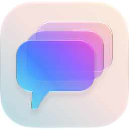
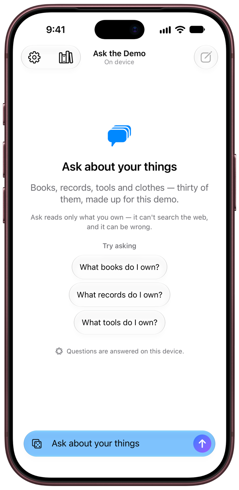
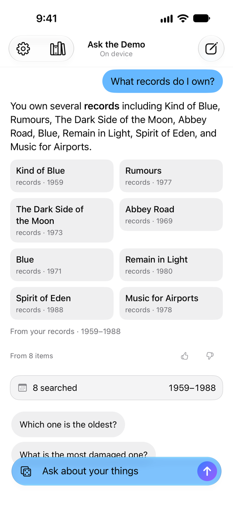
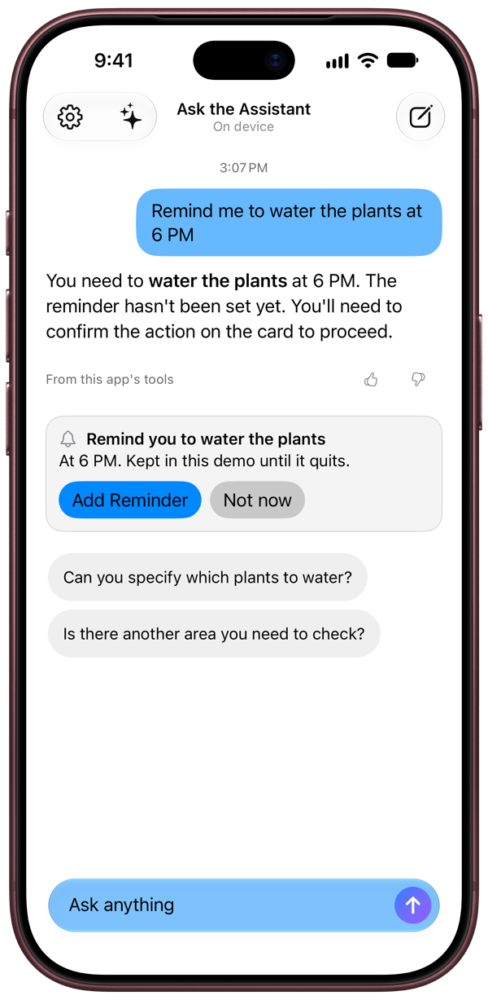
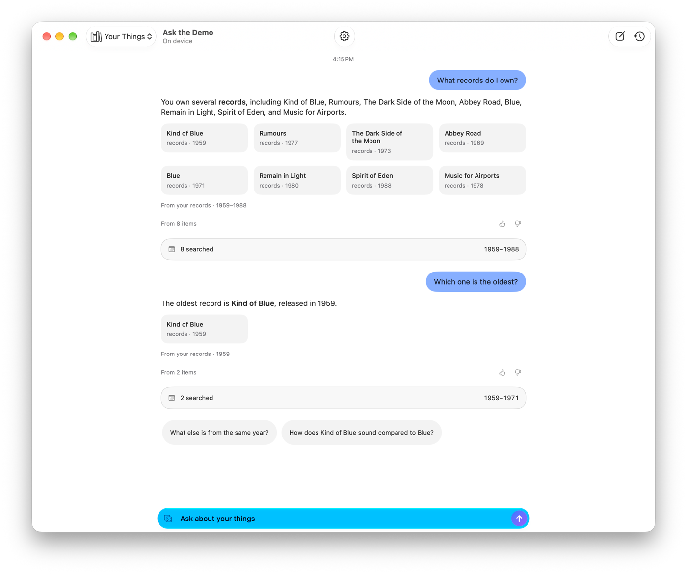
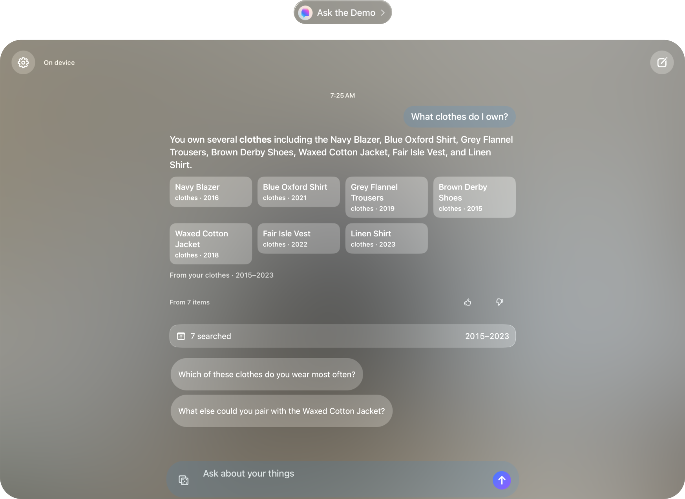
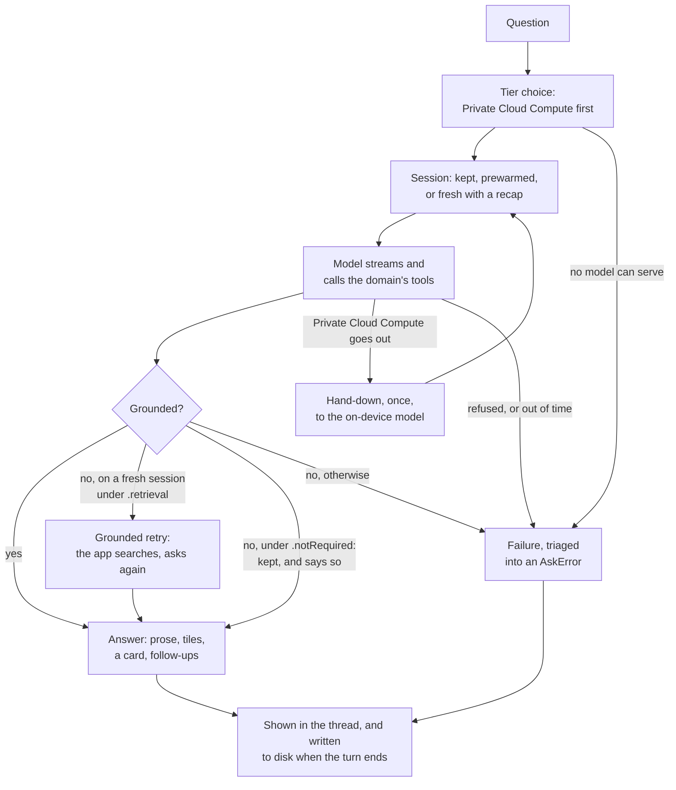

<p align="center">
  <picture>
    <source media="(prefers-color-scheme: dark)" srcset="https://github.com/gregyuzik/AskKit/raw/main/docs/images/icon-dark.png">
    
  </picture>
</p>

# AskKit

[](https://github.com/gregyuzik/AskKit/actions/workflows/ci.yml)
[](Package.swift)
[](Package.swift)
[](LICENSE)

**An Ask screen for SwiftUI apps, on Apple's Foundation Models.** Readers ask about your app's data in
their own words and get short answers, grounded in what your tools return. Private Cloud Compute
answers when it can, and the on-device model when it can't.

<p align="center">
  <picture>
    <source media="(prefers-color-scheme: dark)" srcset="https://github.com/gregyuzik/AskKit/raw/main/docs/images/iphone-first-dark.png">
    
  </picture>
  <picture>
    <source media="(prefers-color-scheme: dark)" srcset="https://github.com/gregyuzik/AskKit/raw/main/docs/images/iphone-answer-dark.png">
    
  </picture>
  <picture>
    <source media="(prefers-color-scheme: dark)" srcset="https://github.com/gregyuzik/AskKit/raw/main/docs/images/iphone-card-dark.png">
    
  </picture>
</p>
<p align="center">
  <picture>
    <source media="(prefers-color-scheme: dark)" srcset="https://github.com/gregyuzik/AskKit/raw/main/docs/images/mac-dark.png">
    
  </picture>
  
</p>

## Features

- **One protocol.** Your `AskDomain` gives the model its tools and instructions. AskKit supplies the
  engine (`AskCore`) and the SwiftUI screen (`AskUI`).
- **Grounded answers.** By default an answer has to stand on your data: when the model doesn't search,
  the app searches for it and asks again.
- **Both models, chosen for you.** Private Cloud Compute first, the on-device model otherwise, and a
  turn handed down when Private Cloud Compute goes out.
- **Actions the reader confirms.** A tool can propose an action, such as adding a reminder, that runs
  only once the reader taps yes.
- **The whole screen.** Streaming answers, tiles for the rows an answer names, follow-ups, chat
  history, a Mac menu and a settings card, on iOS, macOS and visionOS, iPhone Duo included.
- **Every reader.** 25 languages, VoiceOver, Dynamic Type and Reduce Motion.
- **Private.** No dependencies, no analytics and no network requests of its own.

## Requirements

- Xcode 27.2 or later on an Apple silicon Mac, Swift 6.4.2, and a deployment target of 27.2.
- Apple Intelligence on the reader's device. Where no model can serve, the first screen says why.
- Optional: the [Private Cloud Compute entitlement](https://developer.apple.com/documentation/BundleResources/Entitlements/com.apple.developer.private-cloud-compute),
  which Apple grants to eligible developers on request. Without it, every question is answered on the
  device.

Ask shows on iOS, macOS and visionOS. Both libraries also build for tvOS and watchOS, so a shared
package can depend on them ([Platforms](docs/ADOPTING.md#platforms)).

## Install

In Xcode, File > Add Package Dependencies with this repository's URL, or in a `Package.swift`:

```swift
platforms: [.iOS("27.2"), .macOS("27.2"), .visionOS("27.2")],
dependencies: [.package(url: "https://github.com/gregyuzik/AskKit", from: "0.7.2")],
// and in the target that shows the screen:
dependencies: [.product(name: "AskCore", package: "AskKit"), .product(name: "AskUI", package: "AskKit")]
```

`AskUI` doesn't re-export `AskCore`, so a file that uses both imports both. AskKit is at 0.x, where a
minor version may break the API: [CHANGELOG.md](CHANGELOG.md) says what changed. Enhanced Security,
versions and enums: [docs/ADOPTING.md](docs/ADOPTING.md#install).

## Adopt

Two steps get an app answering. The code is
[`ReadmeDomain.swift`](Tests/AskCrossPostureTests/ReadmeDomain.swift), which the package's tests
compile and run.

### 1. Implement `AskDomain`

The domain names its row, gives the model its tools and instructions, and runs the same search when
the model won't:

```swift
/// Everything about Ask that is this app's rather than AskKit's.
nonisolated struct LibraryDomain: AskDomain {
    typealias Row = Book
    typealias SearchArguments = BookQuery

    let brand = AskBrand(
        title: "Ask My Library",
        appDirectory: "MyLibrary",
        logSubsystem: "com.example.mylibrary",
        help: "Ask about your books",
        firstScreenHeadline: "Ask about your books",
        firstScreenSentence: "Find, count and compare what is on your shelves.",
        nothingToAskCopy: "Add a book to start asking.",
        disclosureSentence: "Questions are answered on this device.",
        scopeCaveat: "Ask reads only your library. It can't search the web, and it can be wrong."
    )

    func overview() async -> AskOverview {
        let count = Book.shelf.count
        return AskOverview(scopes: [AskOverview.Scope(id: "books", name: "books", count: count)], total: count)
    }

    func makeTools(_ context: AskToolContext<Book>) -> [any Tool] {
        [SearchBooks(context: context)]
    }

    func instructions(tier: AskTier, isConversation: Bool, answerLanguage: String?) -> String {
        // In English, naming no language: AskKit adds Apple's sentences for the locale and the language.
        """
        You answer questions about the books one person owns, and about nothing else.
        Call search_books before you answer, and name only titles it returned.
        """
    }

    func search(_ arguments: BookQuery, context: AskToolContext<Book>) async throws -> String {
        try await SearchBooks(context: context).call(arguments: arguments)
    }

    // Optional. Without it the first screen has its copy and the composer, and no chips.
    func starters(overview: AskOverview, window: Int) -> [AskStarter] {
        [AskStarter(text: "How many books do I own?"), AskStarter(text: "Which of my books is by Ursula K. Le Guin?")]
    }
}
```

<details>
<summary>The row, the search's arguments and the tool</summary>

```swift
import AskCore
import Foundation
import FoundationModels

/// One book on the reader's shelf. Every type here is `nonisolated`, because
/// AskKit uses them off the main actor.
nonisolated struct Book: AskRow {
    let id: String
    let title: String
    let author: String

    var displayTitle: String { title }

    /// Stands in for the app's own store.
    static let shelf = [
        Book(id: "b1", title: "The Dispossessed", author: "Ursula K. Le Guin"),
        Book(id: "b2", title: "Housekeeping", author: "Marilynne Robinson"),
        Book(id: "b3", title: "A Pattern Language", author: "Christopher Alexander"),
        Book(id: "b4", title: "1984", author: "George Orwell")
    ]
}

/// The search's arguments: the model fills them in, or the app for the grounded retry.
@Generable
nonisolated struct BookQuery: Sendable {
    @Guide(description: "Words from the question: a title or an author. Short and literal.")
    var words: String
}

/// The one lookup: the model's tool, and the grounded retry's search.
nonisolated struct SearchBooks: Tool {
    let name = "search_books"
    let description = "Search the reader's books by any words from the question. Call this before answering anything about what they own."

    let context: AskToolContext<Book>

    // `@concurrent`, or the lookup runs on its caller's actor.
    @concurrent func call(arguments: BookQuery) async throws -> String {
        // Notes the call, finishes it however the lookup ends, then reports what it read.
        await context.withToolCall(.searching(scope: nil)) { collector in
            // A one-letter word, such as "a" or "I", names nothing to look for.
            let asked = Self.words(arguments.words).filter { $0.count > 1 }
            let matches = Book.shelf.filter { !Self.words("\($0.title) \($0.author)").isDisjoint(with: asked) }
            // Nothing matched, as for "How many books do I own?": the whole shelf, to count or look through.
            let found = matches.isEmpty ? Book.shelf : matches
            let shown = Array(found.prefix(context.rowLimit))
            // An answer's tiles resolve only against recorded rows.
            await collector.record(rows: shown)
            let reply = Self.render(shown, of: found.count, matched: !matches.isEmpty)
            return (reply, report: .reading(shown: shown.count, total: found.count, scope: nil))
        }
    }

    // Whole words of letters or digits, ignoring case and accents: "garcia marquez" finds
    // "García Márquez", "1984" is a word, and "le" isn't found inside "Alexander".
    private static func words(_ text: String) -> Set<String> {
        let words = text.split(whereSeparator: { !$0.isLetter && !$0.isNumber })
        return Set(words.map { $0.folding(options: [.caseInsensitive, .diacriticInsensitive], locale: nil) })
    }

    // Every field clamped, so none can spell a tag to the model, and no fence of its own.
    private static func render(_ shown: [Book], of total: Int, matched: Bool) -> String {
        guard !shown.isEmpty else { return "The shelf is empty." }
        var lines = matched ? [] : ["No book matched, so this is the whole shelf."]
        lines += shown.map { "\(AskPrompt.clamp($0.title, AskPrompt.shortClamp)) | \(AskPrompt.clamp($0.author, AskPrompt.shortClamp))" }
        if total > shown.count { lines.append("(+\(total - shown.count) more not shown)") }
        return lines.joined(separator: "\n")
    }
}
```

</details>

A tool keeps three rules:

- **It reports every call.** It runs its work in `context.withToolCall`, and records every row it shows
  with `record(rows:)`: an answer's tiles resolve only against recorded rows.
- **It returns bare text.** Every field goes through `AskPrompt.clamp`, and the lines carry no fence:
  AskKit fences what it composes.
- **Its search is written once.** `search(_:context:)` runs the tool's own code, so the grounded retry
  reads what the tool would have.

### 2. Make the engine, and show the screen

```swift
import AskCore
import AskUI
import SwiftUI

/// The one Ask, owned by the app and not by a view, so the thread outlives every view.
@MainActor
final class LibraryAsk {
    let store: AskConversationStore<LibraryDomain>

    init() {
        let domain = LibraryDomain()
        // `.declared` only if the entitlements file holds Private Cloud Compute's.
        let seam = AppleModelSeam.make(privateCloudCompute: .undeclared)
        let engine = AskEngine(domain: domain, seam: seam)
        store = AskConversationStore(engine: engine)
    }
}

/// The screen in a navigation stack, titled with the brand's title.
struct AskTab: View {
    let ask: LibraryAsk

    var body: some View {
        NavigationStack {
            AskScreen(store: ask.store)
                .navigationTitle(ask.store.brand.title)
        }
    }
}
```

Hold the store at app scope, for example as `@State private var ask = LibraryAsk()` in your `App`, so
the thread outlives every view. The screen puts New Chat, History and the model's caption in the
toolbar, so it needs a navigation stack.

### Then add what you need

Tiles that open your rows, actions the model proposes, photos, the composer in the tab bar, the Mac
menu, the settings card and tips: [docs/ADOPTING.md](docs/ADOPTING.md) covers each, and every member of
`AskDomain`.

<details>
<summary>A domain without rows</summary>

A domain whose tools work something out or act, rather than read your data, leaves out the row, the
search and the overview. It keeps answers no tool grounded with `.notRequired`, and asks for `.prose`
replies, which have no tiles. This is
[`ReadmeAssistantDomain.swift`](Tests/AskCrossPostureTests/ReadmeAssistantDomain.swift):

```swift
import AskCore
import Foundation
import FoundationModels

/// The converter's arguments, which the model fills in.
@Generable
nonisolated struct Conversion: Sendable {
    @Guide(description: "The amount to convert.")
    var amount: Double
    @Guide(description: "The unit it is in: km, m, mi or ft.")
    var from: String
    @Guide(description: "The unit to convert it to: km, m, mi or ft.")
    var to: String
}

/// A tool that reads none of the app's data: it works the answer out and returns it as text.
nonisolated struct ConvertDistance: Tool {
    let name = "convert_distance"
    let description = "Convert a distance from one unit to another."

    let context: AskToolContext<AskNoRow>

    private static let units: [String: UnitLength] = [
        "km": .kilometers, "m": .meters, "mi": .miles, "ft": .feet
    ]

    @concurrent func call(arguments: Conversion) async throws -> String {
        // Noted as a call, so the turn counts as grounded by it. It records no rows.
        await context.withToolCall { _ in
            guard let from = Self.units[arguments.from.lowercased()],
                  let to = Self.units[arguments.to.lowercased()] else {
                // The model's own words, clamped like any field before they go back to it.
                let asked = "\(AskPrompt.clamp(arguments.from, AskPrompt.shortClamp)) to \(AskPrompt.clamp(arguments.to, AskPrompt.shortClamp))"
                return ("No conversion from \(asked).", report: nil)
            }
            let result = Measurement(value: arguments.amount, unit: from).converted(to: to).value
            return (String(format: "%g %@ = %g %@", arguments.amount, from.symbol, result, to.symbol), report: nil)
        }
    }
}

/// An assistant with no rows of its own: three members, the policy that keeps an answer no tool grounded, and a reply with no tiles.
nonisolated struct AssistantDomain: AskDomain {
    let brand = AskBrand(
        title: "Ask the Assistant",
        appDirectory: "MyAssistant",
        logSubsystem: "com.example.myassistant",
        help: "Ask anything",
        firstScreenHeadline: "Ask anything",
        firstScreenSentence: "Convert a distance, or ask a question.",
        disclosureSentence: "Questions are answered on this device.",
        scopeCaveat: "Answers come from the model and its tools, and they can be wrong."
    )

    // Optional. The default, `.retrieval`, would fail every answer no tool grounded, "thanks" included.
    var grounding: AskGroundingPolicy { .notRequired }

    // Optional. The default, `.full`, also has the model name a question kind and choose tiles, which this domain never shows.
    var replyShape: AskReplyShape { .prose }

    func makeTools(_ context: AskToolContext<AskNoRow>) -> [any Tool] {
        [ConvertDistance(context: context)]
    }

    func instructions(tier: AskTier, isConversation: Bool, answerLanguage: String?) -> String {
        // In English, naming no language: AskKit adds Apple's sentences for the locale and the language.
        """
        You are a helpful assistant inside an app. Answer in a few plain sentences.
        To convert a distance, call convert_distance and give its result.
        """
    }
}
```

</details>

<details>
<summary>Adopt with a coding assistant</summary>

Give Claude Code, Xcode's coding intelligence or Cursor this prompt in your app's project, then review
what it writes against the steps above.

```text
Add AskKit (https://github.com/gregyuzik/AskKit) to this app, so a reader can ask about the app's
data in their own words.

1. Add the Swift package https://github.com/gregyuzik/AskKit from "0.7.2" to the app target, and
   link its AskCore and AskUI products. AskUI doesn't re-export AskCore, so a file that uses both
   imports both.
2. Before writing code, read README.md, docs/ADOPTING.md and docs/ARCHITECTURE.md in that
   repository, and use only the API they and AskKit's doc comments name. Then study this app's data
   model: its types, where they are stored and how the app queries them.
3. Follow the README's Adopt steps. Implement one AskDomain over the app's data: Row (an AskRow),
   SearchArguments (@Generable), brand (an AskBrand), overview(), makeTools(_:),
   instructions(tier:isConversation:answerLanguage:), search(_:context:) and
   starters(overview:window:). Each tool runs its work in context.withToolCall, records every row it
   shows with record(rows:), clamps every field with AskPrompt.clamp and returns its lines unfenced.
   Choose grounding: .retrieval, .toolCall or .notRequired. If the tools read none of the app's
   rows, follow the README's "A domain without rows" instead.
4. Make one seam with AppleModelSeam.make(privateCloudCompute: .undeclared), passing .declared only
   if the app's entitlements file grants com.apple.developer.private-cloud-compute, and one
   AskEngine(domain:seam:).
5. Own one AskConversationStore(engine:) at app scope, outside any view.
6. Show AskScreen(store:) in a NavigationStack with .navigationTitle(store.brand.title), where the
   app wants Ask, such as a tab of its own.
7. Put the brand's copy, the starters and every other string the reader sees in the app's String
   Catalog, resolved with String(localized:).
8. Set the deployment target to 27.2 or later on every platform. In a target with main-actor default
   isolation, mark the types AskKit uses off the main actor nonisolated and each tool's call
   @concurrent. Ask shows on iOS, macOS and visionOS: in a target that also builds for tvOS or
   watchOS, gate Ask's code as docs/ADOPTING.md's "Platforms" describes.
9. Build and run. A development build answers on the device until you opt in to Private Cloud
   Compute: https://github.com/gregyuzik/AskKit#development-builds-and-private-cloud-compute
```

</details>

## Development builds and Private Cloud Compute

A development build answers on the device. Private Cloud Compute's daily quota belongs to the iCloud
account, so AskKit keeps Debug builds, simulators, test runs and development-signed binaries off it,
and never holds back a TestFlight or App Store build. To measure the tier in development, launch a
build signed with the entitlement with `ASK_LIVE_PCC=1` in its environment.
[docs/ADOPTING.md](docs/ADOPTING.md#private-cloud-compute) has the rest: the entitlement check, the
quota, and holding every model call for a screenshot run.

## Privacy

On the device, nothing leaves it. On Private Cloud Compute, a turn sends your instructions and tools,
the prompt (the reader's question, a recap of the thread and your lines), what your tools return, and
a photo when the question has one, under Apple's terms. AskKit sends nothing anywhere else, and its
privacy manifest declares no tracking and no collected data. The thread is kept in your app's
Application Support folder, excluded from backup:
[what is stored, and where](docs/ADOPTING.md#what-is-stored-and-where).

## The demo

Open `Demo/AskKitDemo.xcodeproj` and run `AskKitDemo_iOS` on an iPhone 18 Pro simulator, or
`AskKitDemo_macOS` or `AskKitDemo_visionOS`. Neither the simulator nor the Mac needs signing. It hosts
two domains: a library of thirty things to ask about, and an assistant that converts units and
proposes reminders. A real answer needs Apple Intelligence, and `-askScriptedAnswer` answers without a
model. The demo has no Private Cloud Compute entitlement, so it answers on the device. Its launch
arguments and project: [docs/DEMO-PROJECT.md](docs/DEMO-PROJECT.md).

## How it behaves

Eight house rules govern the engine and the screen.
[ARCHITECTURE.md](docs/ARCHITECTURE.md#5-the-house-rules) gives the reason for each.

1. Private Cloud Compute answers every turn it can, and the on-device model the rest. The reader gets
   no switch.
2. By default, an answer with no retrieval behind it is never shown.
3. Instructions are yours and short, and whatever the reader or a tool wrote is data, fenced and
   clamped.
4. Nothing animates on tokens or tool payloads.
5. Nothing shown is taken back.
6. A session's tool set is fixed for its life, and a warm session only starts a conversation.
7. Every string ships in all 25 languages, and the model's question kind, never an English word list,
   decides whether an answer shows tiles.
8. Reduce Motion has an answer in every animation, VoiceOver hears every terminal state, and Dynamic
   Type scales the marks.

## Architecture



AskUI's store starts a turn and draws it, and AskCore's engine runs everything between: one turn at a
time, under one deadline. [docs/ARCHITECTURE.md](docs/ARCHITECTURE.md) describes each step, the
screen, the designs that were rejected and a glossary.

## Contributing

[CONTRIBUTING.md](CONTRIBUTING.md) has the toolchain, the checks and the pull-request rules. No test
asks a real model: the engine and the store run against scripted sessions. Report a vulnerability
privately, as [SECURITY.md](SECURITY.md) says. Everyone taking part follows the
[code of conduct](CODE_OF_CONDUCT.md). The screen's design draws on
[docs/DESIGN-RESEARCH.md](docs/DESIGN-RESEARCH.md).

## Built with AskKit

[Klosyt](https://apps.apple.com/app/id6758277603), a wardrobe;
[Kabynyt](https://apps.apple.com/app/id6771412493), a collection; and
[vultyr](https://apps.apple.com/app/id6761264004), a service-status monitor.

## License

MIT: see [LICENSE](LICENSE).
